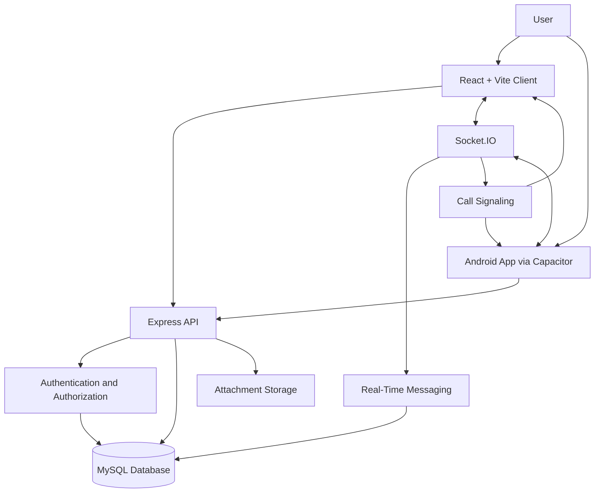

# NFaNG — Full-Stack Real-Time Chat Application 💬

**A modern messaging platform with real-time communication, group conversations, audio/video calling, and an Android client.**

NFaNG is a full-stack chat application built with React, Vite, Express, Socket.IO, and MySQL. It brings together direct messaging, group conversations, media sharing, account management, and real-time communication in a responsive web interface with Android support.

The project explores full-stack application development, real-time event-driven communication, authentication, database design, and cross-platform deployment.

<p align="center">
  <a href="https://github.com/Anshul-sys32/Chat-App">
    <strong>Explore the Repository</strong>
  </a>
</p>

---

## ✨ Features

### 💬 Messaging and Conversations

- **Real-time messaging** with Socket.IO.
- **Direct messages** for one-to-one conversations.
- **Group chats** with group membership and role management.
- **Message replies** with quoted sender information and previews.
- **Paginated conversation history** for navigating older messages.
- **Unread message counts** maintained across conversations.
- **Online user discovery** with separate local and global user lists.
- **Persistent notifications** that remain available after reconnecting.

### 📎 Media Sharing

- Support for image, video, audio, and PDF attachments.
- Multiple attachments per message, subject to upload limits.
- Profile picture uploads and group images.
- Custom stickers managed through the administration interface.
- Persistent attachment storage on the backend.

### 📞 Audio and Video Calling

- Audio and video calling capabilities.
- Browser camera and microphone access.
- Audio output device selection where supported.
- Call history with options to manage stored call records.
- Real-time signaling through the application server.

*Calling functionality depends on browser permissions, secure-context requirements, network connectivity, and server configuration.*

### 🔐 Authentication and Account Security

- Account registration and login.
- Email verification using one-time passwords (OTPs).
- Password recovery through email verification.
- Google sign-in integration.
- JWT-based authentication and server-side account checks.
- Password hashing before database storage.
- Administrator approval for newly registered accounts.

### 🛡️ Administration

- Approve, suspend, reactivate, and manage user accounts.
- Assign user roles and manage group membership.
- Search for users and manage account information.
- Send persistent notifications to selected users or active users.
- Manage the custom stickers available in conversations.
- Configure rotating messages displayed on the sign-in page.

### 🎨 User Experience

- Responsive React-based interface.
- Dark and light themes.
- Persistent theme selection.
- User profiles with editable account information.
- Android packaging through Capacitor.

---

## 🛠️ Technology Stack

| Technology | Purpose |
|---|---|
| React | Frontend user interface |
| Vite | Frontend development server and build tooling |
| Node.js | JavaScript runtime |
| Express | Backend HTTP server and API |
| Socket.IO | Real-time messaging and event communication |
| MySQL | Persistent relational data storage |
| JWT | Authentication and access verification |
| Google Identity Services | Google sign-in |
| SMTP | Email verification and password recovery |
| Capacitor | Android application packaging |
| Caddy | HTTPS and reverse-proxy deployment |
| CSS | Interface styling and themes |

---

## 🏗️ Architecture

The application separates the frontend client from the backend server. The frontend communicates with the backend through HTTP APIs and Socket.IO connections, while MySQL stores persistent application data.



### Communication flow

1. The user interacts with the React interface or Android client.
2. HTTP requests handle authentication and application operations.
3. Socket.IO delivers real-time events between connected clients.
4. Express handles backend logic and validates authenticated requests.
5. MySQL stores users, messages, groups, and related application records.
6. The backend manages uploaded attachments and call-related operations.

The diagram represents the application's main logical components rather than every internal implementation detail.

---

## 📁 Project Structure

```text
Chat-App/
├── chatapp/                 # React + Vite frontend
│   ├── src/                 # Application source code
│   ├── public/              # Static assets
│   ├── android/             # Native Android project
│   ├── package.json         # Frontend dependencies and scripts
│   └── .env                 # Local frontend configuration
│
├── chatserver/              # Express + Socket.IO backend
│   ├── server.js            # Server entry point
│   ├── uploads/             # Uploaded attachments
│   ├── package.json         # Backend dependencies and scripts
│   └── .env                 # Database and server configuration
│
├── Caddyfile                # Reverse-proxy configuration
├── LICENSE                  # MIT License
├── .gitignore
└── README.md
```

The exact contents of individual directories may evolve as the project develops.

---

## 🚀 Getting Started

### Prerequisites

Install the following before starting the application:

- Node.js 18 or newer.
- npm.
- MySQL 8 or a compatible MySQL server.
- Git.
- A modern browser.

Email verification and password recovery require working SMTP credentials. Google sign-in requires a configured Google OAuth client.

### 1. Clone the repository

```bash
git clone https://github.com/Anshul-sys32/Chat-App.git
cd Chat-App
```

### 2. Configure the database

Create a MySQL database:

```sql
CREATE DATABASE chatapp;
```

Configure the backend environment in `chatserver/.env`:

```dotenv
PORT=5175
NODE_ENV=development

DB_HOST=localhost
DB_PORT=3306
DB_USER=root
DB_PASSWORD=your_mysql_password
DB_NAME=chatapp

JWT_SECRET=your_long_random_secret
GOOGLE_CLIENT_ID=your_google_oauth_client_id

FRONTEND_ORIGIN=http://localhost:5174

SMTP_HOST=smtp.example.com
SMTP_PORT=587
SMTP_SECURE=false
SMTP_USER=your_smtp_username
SMTP_PASS=your_smtp_password
MAIL_FROM=NFaNG <no-reply@example.com>
```

Use the environment variable names expected by the checked-out backend version. Configure a strong, private JWT signing secret and valid credentials for your environment.

The server initializes the required database tables at startup.

**Security:** Never commit `.env` files, passwords, private signing keys, or OAuth secrets to GitHub.

### 3. Install and start the backend

Open a terminal in the repository root:

```bash
cd chatserver
npm install
npm run dev
```

The backend is configured to use port `5175` in the development setup above. Check your environment configuration and terminal output if you use another port.

### 4. Configure the frontend

In a second terminal:

```bash
cd Chat-App/chatapp
```

Create or update `chatapp/.env`:

```dotenv
VITE_API_URL=http://localhost:5175
VITE_SERVER_URL=http://localhost:5175
VITE_SOCKET_URL=http://localhost:5175
```

These URLs should point to the backend server reachable by the browser. Use the correct host and protocol for your environment.

### 5. Install and run the frontend

From the `chatapp` directory:

```bash
npm install
npm run dev
```

Open the local URL printed by Vite, typically:

```text
http://localhost:5174
```

You should now be able to access the application. Features such as email verification and Google sign-in require their respective services to be configured.

---

## 🔑 Authentication Configuration

### Email verification

Configure a working SMTP provider in `chatserver/.env`. The application uses six-digit verification codes during registration and password recovery.

Verification codes expire after a limited period and have restrictions on failed attempts and resend frequency.

### Google sign-in

Create a Google OAuth 2.0 client configured as a Web application in the Google Cloud Console.

Add the appropriate development and production origins to the authorized JavaScript origins. Set the resulting client ID in the backend environment and follow the application's server-side credential verification flow.

### Administrator access

Newly registered accounts require administrator approval before they can sign in.

To bootstrap the first administrator, register the intended account and update its role and status directly in the configured database:

```sql
UPDATE users
SET role = 'admin', status = 'active'
WHERE email = 'admin@example.com';
```

Replace the example email with the account you intend to administer. Run this operation only against your own database and only after verifying the account.

---

## 📱 Android Application

The React client can be packaged as a native Android application using Capacitor.

### Requirements

- Android Studio.
- Android SDK Platform 36.
- The Node.js dependencies required by the frontend.
- A reachable backend URL.

### Build and synchronize

From the `chatapp` directory:

```bash
npm install
npm run android:sync
npm run android:open
```

Open the Android project in Android Studio and run the application on an emulator or connected device.

Before building, configure `chatapp/.env` with the appropriate API and Socket.IO URLs. A phone cannot use the development computer's `localhost` address to reach the backend.

Camera and microphone features require permissions and a secure browser context or suitable native configuration. Google sign-in may also require a dedicated native OAuth flow for reliable operation inside an embedded WebView.

---

## 🌐 Deployment

The project includes a Caddy reverse-proxy configuration for hosting the application behind HTTPS.

A typical deployment involves:

1. Building the React frontend.
2. Serving the built frontend and backend through the configured server.
3. Configuring MySQL and production environment variables.
4. Setting up a domain and DNS records.
5. Configuring HTTPS and reverse proxying through Caddy.
6. Ensuring the server can accept the required HTTP and WebSocket connections.
7. Persisting and backing up the database and uploaded files.

For the current single-origin deployment setup:

```bash
cd chatapp
npm install
npm run build

cd ../chatserver
npm install
npm start
```

Configure Caddy to proxy the public HTTPS hostname to the backend server port configured for the deployment.

**Important:** The Vite development server is intended for development, not production hosting. Use the built frontend for deployment, protect all secrets, and configure appropriate production access controls and network rules.

---

## 🧪 Development Notes

- Run the backend and frontend in separate terminals during local development.
- Verify database credentials before starting the backend.
- Configure SMTP before testing email-dependent flows.
- Check browser permissions when testing camera and microphone functionality.
- Use HTTPS for remote browser-based audio and video calling.
- Keep uploaded files on persistent storage and back them up alongside the database.
- Test authorization and account status enforcement on the server, not only in the frontend.

---

## 🔒 Security and Privacy

The application handles account information, conversations, uploaded files, and authentication credentials.

- Use strong environment-specific secrets.
- Never expose database credentials or private keys in frontend variables.
- Keep the backend's authorization checks enabled for protected operations.
- Restrict production CORS origins to trusted application origins.
- Configure HTTPS for public deployments.
- Back up the database and attachment directory securely.
- Review uploaded-file access rules before storing sensitive information.

Attachment URLs may be accessible to anyone who obtains the URL, so avoid treating an unguessable URL as a replacement for access control.

---

## 🗺️ Future Scope

Potential areas for continued improvement include:

- Message search and richer conversation filters.
- Enhanced delivery and read-status indicators.
- More robust reconnection and offline behavior.
- Improved mobile notifications.
- Expanded accessibility and responsive design.
- Additional automated tests for authentication, messaging, and group permissions.
- More comprehensive deployment and operational monitoring.

These are possible extensions, not claims that the features are already implemented.

---

## 🤝 Contributing

Contributions and suggestions are welcome.

1. Fork the repository.
2. Create a feature branch.
3. Implement and test your changes.
4. Commit your changes with a descriptive message.
5. Push the branch and open a pull request.

Please avoid including secrets, local environment files, database dumps, or personal attachments in contributions.

## 📄 License

This project is licensed under the **MIT License**. See [`LICENSE`](LICENSE) for the full license text.

## 👨‍💻 Author

**Anshul Chauhan**

- GitHub: [@Anshul-sys32](https://github.com/Anshul-sys32)
- Repository: [Chat-App](https://github.com/Anshul-sys32/Chat-App)

---

<p align="center">
  <strong>Built with React, Node.js, Socket.IO, and MySQL.</strong>
  <br />
  Designed to bring real-time communication to web and Android.
</p>
